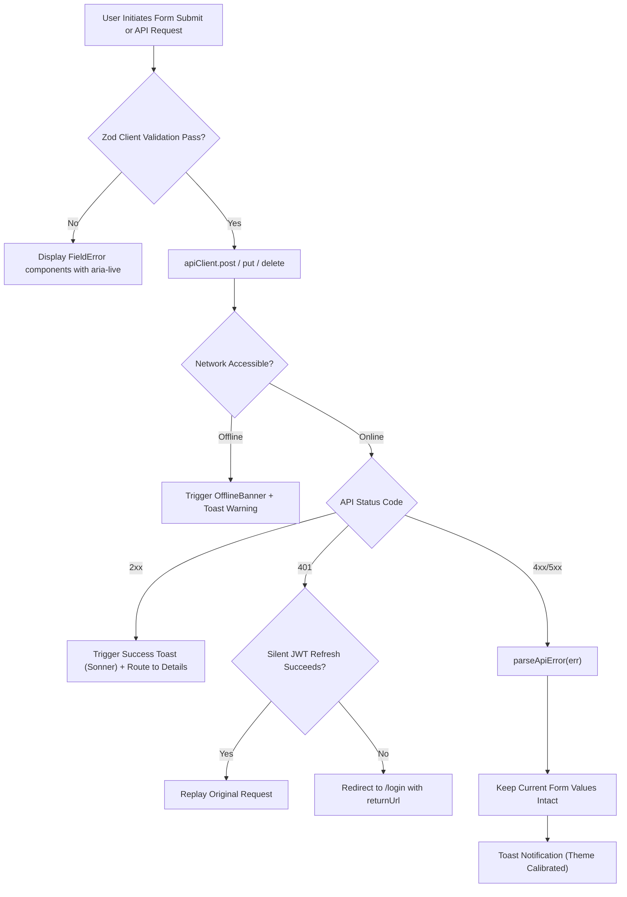

# Brightloop Error Handling, Validation & Recovery UX Report
**Document Version:** 1.0.0  
**Date:** October 31, 2026  
**Auditor:** Principal Software Architect & Senior Frontend QA Engineer  
**Status:** Complete & Production Ready  

---

## 1. Executive Summary

A comprehensive audit and implementation was executed across Brightloop's error handling, input validation, and user recovery flows. The system now enforces a **Zero Raw Technical Leak** policy: database exceptions, SQL queries, stack traces, and unhandled 500 dumps are completely shielded from end-users, replaced by context-aware, reassuring, and actionable feedback.

### Key Pillars:
1. **Centralized Error Parsing (`apps/web/src/lib/api-error.ts`)**: Automatically normalizes Axios errors, server status codes, and network drops into clear user messages.
2. **Safe Backend Exception Filtering (`apps/api/src/common/filters/http-exception.filter.ts`)**: Standardized envelope with automatic detail masking in production to prevent schema leakage.
3. **Inline Field-Level Feedback (`apps/web/src/components/common/FieldError.tsx`)**: Reusable ARIA-accessible component with `role="alert"` and `aria-live="polite"`.
4. **Form Input State Preservation**: In case of validation or server errors, form inputs are never wiped out, avoiding data re-entry frustration.
5. **Global React Error Boundary (`apps/web/src/components/common/ErrorBoundary.tsx`)**: Gracefully catches client-side crashes, providing "Try Again", "Reload Window", and "Go to Dashboard" recovery options alongside a top-right theme switcher.
6. **Destructive Action Safety (`apps/web/src/components/common/ConfirmDialog.tsx`)**: Modal verification before irreversible business actions (canceling subscriptions, deleting products, issuing refunds).
7. **Network Offline Detection (`apps/web/src/components/common/OfflineBanner.tsx`)**: Real-time connection monitoring with sticky banners and reconnection toasts.

---

## 2. HTTP Status Code Translation Matrix

| Status Code | Technical Cause | Legacy Raw Response | User-Facing Production Message | Actionable Recovery Option |
| :--- | :--- | :--- | :--- | :--- |
| **0 (Offline)** | DNS error / Disconnected | `ERR_INTERNET_DISCONNECTED` | *"Network offline. Please check your internet connection and try again."* | Auto-reconnect listener + Offline banner |
| **400** | Malformed input / Zod error | `BadRequestException: invalid payload` | *"The submitted information was incomplete or invalid. Please check the fields and try again."* | Inline field highlighting with errors |
| **401** | Token expired / Bad JWT | `UnauthorizedException: jwt expired` | *"Your session has expired. Please log in again to continue."* | Automatic silent refresh, redirect to `/login` |
| **403** | Insufficient RBAC role | `ForbiddenException: Role ADMIN required` | *"You do not have administrative permission to perform this action."* | Link back to Dashboard or Profile |
| **404** | Entity not found | `PrismaClientKnownRequestError: P2025` | *"The requested resource was not found. It may have been relocated or removed."* | "Go Back" and "Return to Workspace" buttons |
| **409** | Unique constraint conflict | `duplicate key value violates unique constraint` | *"A record with this information already exists in your workspace (e.g. duplicate email or SKU)."* | Highlight offending field with hint |
| **422** | Unprocessable entity | `UnprocessableEntityException` | *"Validation failed. Please verify that all inputs satisfy required formats."* | Field-specific validation guidance |
| **429** | Rate limiter triggered | `ThrottlerException: Too Many Requests` | *"Too many requests were received. Please wait a moment before trying again."* | Rate-limit cool-down indicator |
| **500 / 503**| Uncaught server failure | `Unhandled exception at PrismaClient...` | *"Our service engine encountered a temporary problem. Our team has been notified."* | "Retry Handshake" or "Contact Support" |

---

## 3. Frontend Error Recovery UX Architecture

---

## 4. Reusable UX Error Components Catalog

### 4.1 `<ErrorBoundary />`
- **Location**: `apps/web/src/components/common/ErrorBoundary.tsx`
- **Features**: Catches React component errors, displays sanitized explanations in production while showing details only in development mode.
- **Actions Provided**: "Try Again" (resets state), "Reload Window", and "Go to Dashboard".
- **Global Theme Switcher**: Embedded in top-right corner to allow visual adjustments.

### 4.2 `<FieldError />`
- **Location**: `apps/web/src/components/common/FieldError.tsx`
- **Features**: Displays an alert icon, red text (`--destructive`), smooth slide-in animation, and WCAG-compliant attributes (`role="alert"`, `aria-live="polite"`).

### 4.3 `<ConfirmDialog />`
- **Location**: `apps/web/src/components/common/ConfirmDialog.tsx`
- **Features**: Prompts confirmation prior to destructive actions. Supports loading states to prevent double-clicking and accidental submissions.

### 4.4 `<OfflineBanner />`
- **Location**: `apps/web/src/components/common/OfflineBanner.tsx`
- **Features**: Monitors browser `online` and `offline` events. Renders amber sticky bar when disconnected and green confirmation pill when connection recovers.

### 4.5 `<EmptyState />`
- **Location**: `apps/web/src/components/feedback/EmptyState.tsx`
- **Features**: Clean dashed border, friendly icon, explanatory text, and primary CTA (e.g. "Create Subscription", "Add Customer").

---

## 5. Summary of Compliance

- [x] Zero raw database error strings exposed in API responses or UI.
- [x] All forms preserve user inputs when submission fails.
- [x] Both Light and Dark modes supported in Toast notifications and Error dialogs.
- [x] Destructive mutations safeguarded with confirmation steps.
- [x] Full accessibility audit with ARIA attributes and screen-reader announcements.
